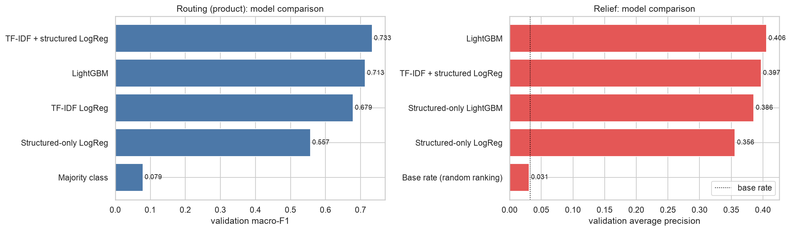
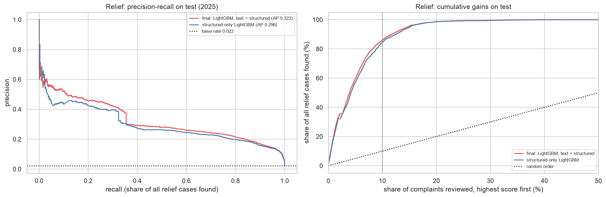
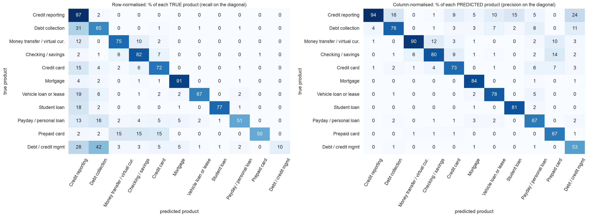

# Routing Consumer Financial Complaints and Predicting Which Ones End in Monetary Relief

Springboard Data Science Career Track · Capstone Three · Jacob Paul

📄 **Project report:** [`reports/project_report.pdf`](reports/project_report.pdf) · 📊 **Model metrics:** [`reports/model_metrics.md`](reports/model_metrics.md)

## The problem

Banks, lenders and credit bureaus receive large volumes of consumer complaints. Each one must be **routed** to the team that handles the product, and compliance teams must decide **which complaints to review first**. Using the text of the complaint and the fields of the complaint form, this project predicts:

1. **the product** a complaint is about, so it can be routed (11 classes; the issue category is a secondary target), and
2. **whether the company closed it with monetary relief** rather than with an explanation, so the complaints most likely to involve real financial harm can be reviewed first.

It also tests a question that matters for any tool like this: **does the narrative add information beyond what the complaint form already records?** The full proposal is in [`proposal/`](proposal/consumer-complaints-capstone-Proposal.pdf).

## Key results (test set: complaints received in 2025, never seen in training)

| Task | Final model | Test result | Baselines on the same test set |
|---|---|---|---|
| **Routing** (11 products) | TF-IDF + structured logistic regression | **macro-F1 0.702**, accuracy 0.90 | majority class 0.076; form fields only 0.558 |
| **Relief** (monetary relief vs explanation) | LightGBM on TF-IDF + structured fields | **average precision 0.322**; the top 10% of the ranking holds **85.9%** of relief cases (lift 8.6) | base rate 0.022; form fields only 0.296 |

- **Routing works well.** At a confidence threshold of 0.9, 76% of complaints could be routed automatically with 96.5% accuracy.
- **Relief prediction works, but mostly through the form fields.** Product, company and issue carry most of the signal. The narrative's gain is statistically significant but small (AP +0.026, 95% CI [0.013, 0.038]). It is largest at the very top of the review queue and inside credit reporting and debt collection, where AP rises 3–4×.
- **Weak results, stated plainly:**
  - Issue routing reaches only macro-F1 0.31, because issue labels overlap and changed over time.
  - Three small product classes stay weak: debt or credit management, prepaid card, and payday loans.

| Model comparison (validation) | Relief on test: precision–recall and gains |
|---|---|
|  |  |


*Routing on the 2025 test set: recall (left) and precision (right) by product.*

## Data

**Source:** the CFPB [Consumer Complaint Database Narratives Archive](https://www.consumerfinance.gov/foia-requests/foia-electronic-reading-room/cfpb-consumer-complaint-database-narratives-archive/). It has 21 CSV exports (`CCDB_Export_1_…` to `CCDB_Export_21_…`, 1.43 GB zipped) with **17,533,918 complaints** received from December 2011 to August 2026.
- About 22% of complaints include a consumer narrative. Narratives exist only for consumers who opted in, starting in March 2015.
- The CFPB stopped publishing narratives on August 14, 2026, so this is a fixed historical extract.
- Licence: CFPB public data.

**How to obtain it:**
1. Download all 21 `CCDB_Export_*.zip` files from the archive page linked above.
2. Unzip them into `data/raw/`, so that it contains 21 `.csv` files.

The raw data (about 9 GB unzipped) is not tracked by git. A 5,000-row sample of cleaned narrative complaints is included in [`data/sample/`](data/sample/).

The notebooks analyse a **uniform random 20% sample** of rows (`SAMPLE_FRAC = 0.20` in notebook 01), so everything runs on a 16 GB laptop. Every share and rate stays unbiased.

## Repository map

```
consumer-complaints-capstone/
├── README.md
├── requirements.txt             exact package versions used (Python 3.14)
├── proposal/                    project proposal (PDF)
├── notebooks/
│   ├── 01_data_wrangling_and_eda.ipynb        collection, cleaning, data dictionary, EDA, statistics
│   ├── 02_preprocessing_and_modeling.ipynb    targets, outcome maturity, time split, one-hot/scaling/TF-IDF,
│   │                                          5 models per task, comparison, final models, single test evaluation
│   └── 03_test_set_assessment.ipynb           confusion matrices, lift, calibration, bootstrap CI, error analysis
├── models/                      final and reference scikit-learn pipelines (.joblib)
├── reports/
│   ├── project_report.pdf       the project report (built from project_report.md)
│   ├── project_report.md        report source
│   ├── build_report.py          Markdown -> PDF (headless Chrome)
│   ├── model_metrics.csv / .md  every model, setting and split; the comparison tables
│   └── figures/                 all figures (01–16 EDA, 20–26 modelling, 30–34 test assessment)
└── data/
    ├── raw/                     the 21 archive exports (not tracked)
    ├── processed/               cleaned data and train/val/test splits (not tracked)
    └── sample/                  5,000-row cleaned sample (tracked)
```

## How to reproduce

```bash
python -m pip install -r requirements.txt          # Python 3.14; see requirements.txt for versions
# put the 21 unzipped CSVs in data/raw/, then run the notebooks in order:
cd notebooks
jupyter nbconvert --to notebook --execute --inplace 01_data_wrangling_and_eda.ipynb      # ~1.5 min
jupyter nbconvert --to notebook --execute --inplace 02_preprocessing_and_modeling.ipynb  # ~30-55 min
jupyter nbconvert --to notebook --execute --inplace 03_test_set_assessment.ipynb         # ~1.5 min
cd .. && python reports/build_report.py                                                  # rebuilds the PDF
```

**Notes for running it:**
- Timings are for a 16 GB MacBook Air (Apple silicon). Notebook 02 peaks at about 6 GB of RAM; close other memory-heavy applications first.
- All random steps use seed 42, and a complete re-run reproduced every metric exactly.
- For a 2-minute check that the code works (not the reported results), run notebook 02 with `NB02_DEV_FRAC=0.05`.

## Method in brief

- **Wrangling:**
  - Products are harmonised to the CFPB's current 11-product taxonomy.
  - Only same-consumer re-submissions are de-duplicated; template letters are kept and flagged.
  - Missing values are handled as explicit categories, and outliers are flagged rather than deleted.
- **Targets:** relief follows the proposal: *monetary relief* vs *closed with explanation*. A sensitivity check also counts non-monetary relief as a negative.
- **Split:**
  - By complaint date: train 2015-03 to 2024-06, validation 2024 H2, test 2025.
  - Narratives with identical text never cross splits.
  - Immature months (July–August 2026) and the changed 2026 population are excluded; January–June 2026 is reported separately.
- **Features:** fitted on train only, inside scikit-learn pipelines:
  - one-hot encoding with min-frequency lumping;
  - a log transform plus standardisation for the linear models;
  - TF-IDF on 1–2-grams;
  - no post-outcome fields.
- **Models:** majority class / base rate, structured-only logistic regression and LightGBM, TF-IDF logistic regression, and LightGBM on text + structured fields. Tuned on validation; the final model is evaluated once on test.

## Limitations

- **Narrative value:** the narrative adds only a small amount to relief prediction overall. Most of the signal is which product, company and issue a complaint concerns.
- **Labels and selection:** labels are what companies recorded, not verified harm. Narratives come from consumers who opted in, so results describe that group.
- **Frozen data:** the archive cannot be refreshed with new narratives. On the changed 2026 population, routing macro-F1 falls to 0.65 and relief lift halves, so the models must be re-validated before use on a different population.
- **Sampling:** results come from a 20% sample of the archive. Two models used 150,000-row training subsamples for compute reasons.

## Author

**Jacob Paul**: [LinkedIn](https://www.linkedin.com/in/jacob25paul) · [GitHub](https://github.com/jacob25paul)
