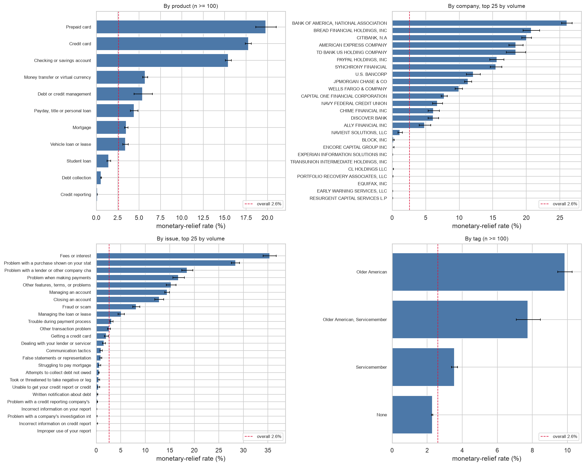
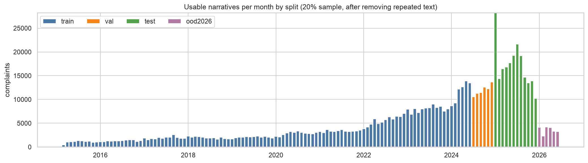
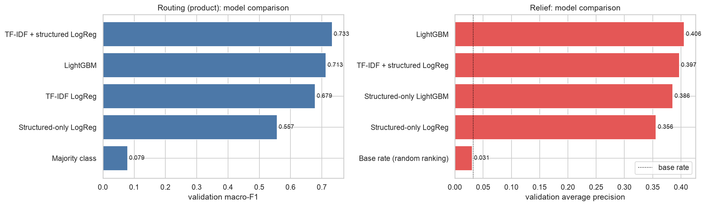
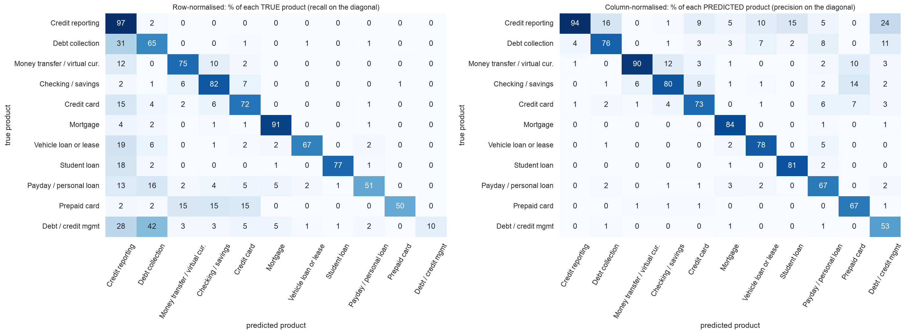
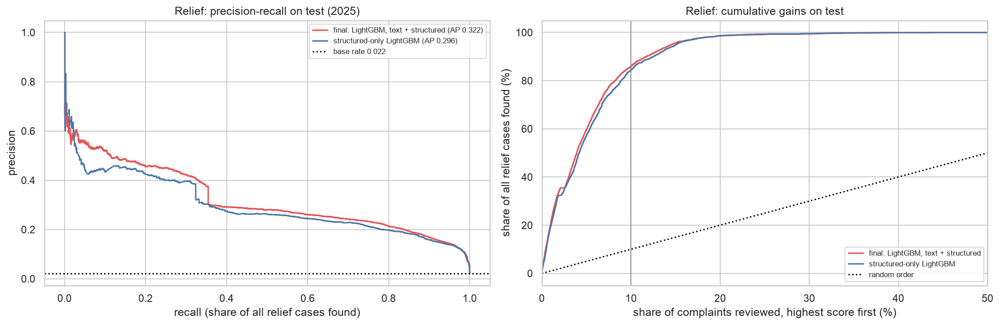
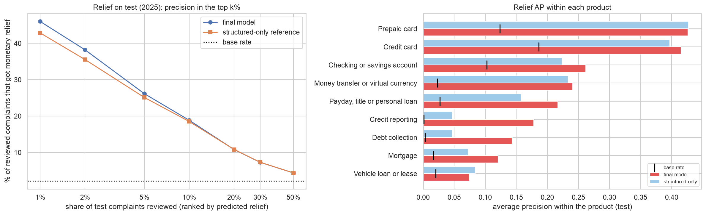
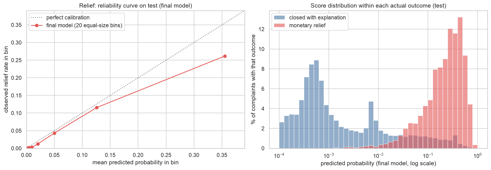

# Routing Consumer Financial Complaints and Predicting Which Ones End in Monetary Relief

Springboard Data Science Career Track · Capstone Three · Jacob Paul 
Notebooks: <code>01_data_wrangling_and_eda</code>, <code>02_preprocessing_and_modeling</code>, <code>03_test_set_assessment</code> · Metrics: <code>reports/model_metrics.csv</code>

## 1. Executive summary

Banks, lenders and credit bureaus receive large volumes of consumer complaints. Each must be **routed** to the team that handles the product, and compliance teams must decide **which complaints to review first**. Using the CFPB Consumer Complaint Database, this project built and tested two models on complaints received in **2025**, a year that none of the models saw during training:

| Task | Final model | Result on the 2025 test set | Baseline on the same test set |
|---|---|---|---|
| **Routing:** predict the product (11 classes) | TF-IDF + structured logistic regression | **macro-F1 0.702**, accuracy 0.90 | majority class 0.076; form fields only 0.558 |
| **Relief:** rank complaints by the chance of monetary relief | LightGBM on TF-IDF + structured fields | **average precision 0.322**; the top 10% of the ranking holds **85.9%** of relief cases | base rate 0.022; form fields only 0.296 |

- **Routing works well.** Complaints where the model's confidence is at least 0.9 (76% of them) are routed with **96.5% accuracy**, so most routing could be automated, with the rest going to a person.
- **Relief prediction works, but mostly through the form fields.** Product, company and issue already rank complaints well. The narrative adds a **statistically significant but small** gain: +0.026 AP, 95% CI [0.013, 0.038]. The gain is concentrated at the very top of the queue, and inside credit reporting and debt collection, where the narrative raises AP 3–4×.
- **Weak spots:** the secondary *issue* routing task (macro-F1 0.31), and three small product classes.

## 2. Problem, stakeholders and success criteria

The project proposal set out two supervised tasks on complaints that include a consumer narrative:

1. **Routing:** predict the product (and, secondarily, the issue) from the complaint.
2. **Relief:** predict whether the company closed the complaint with *monetary relief* rather than *with an explanation*, so a compliance team can review the most likely cases of financial harm first.

It also asked a third question: **does the narrative add information beyond the structured fields of the complaint form?**

The primary stakeholders are complaint-handling and compliance teams. The proposal's success criteria, used unchanged here, are:

- **routing:** macro-F1 clearly above a majority-class baseline, with per-class results;
- **relief:** average precision (AP) above the base rate *and* above a structured-fields-only model, on a later period than training, plus precision in the top 10% of the ranking;
- **narrative:** report plainly if it does not help.

## 3. Data

**Source.** The CFPB [Consumer Complaint Database Narratives Archive](https://www.consumerfinance.gov/foia-requests/foia-electronic-reading-room/cfpb-consumer-complaint-database-narratives-archive/) contains 21 CSV exports covering complaints received from December 2011 to August 2026. The CFPB moved the narratives into this archive when it stopped publishing them in August 2026, so the data is a fixed historical extract.

**Size.**

- The archive holds **17,533,918 complaints** with no duplicate IDs and an identical 16-column schema in every file.
- To fit a 16 GB laptop, all analysis uses a **uniform random 20% sample** (3,505,876 rows). A uniform sample keeps every share and rate unbiased.
- **21.9%** of complaints include a narrative, and **758,548** of those are long enough to model.

**Why the full archive was needed.** The project started with only the newest export (August 2026). It contained a single narrative, so neither task could be studied. Narrative opt-in peaks at 48% (2017), falls to 22% in 2025, and collapses to 2.5% in 2026.

**Limitations of the data:**

- Narratives exist only for consumers who opted in.
- The outcome is recorded by the company, not verified.
- Two fields used in other CFPB extracts (`consumer_disputed`, `consumer_consent_provided`) are absent from the archive.

## 4. Data wrangling

Every decision was checked against the data (notebook 01):

| Step | What the data showed | Decision |
|---|---|---|
| Collection | 21 files, 17,533,918 rows, ISO dates, no unparseable dates | Load all files with a 20% row sample; count every file's rows |
| Duplicates | 61,142 narratives share text, company, product, issue and date with another complaint. Most of these groups span **different ZIP codes**, so they are template letters from different consumers | Drop only same-consumer re-submissions (same text *and* state *and* ZIP): **3,726 rows**. Keep templates and flag them with `narrative_hash` (209,868 complaints share their text) |
| Missing values | `narrative` 78% missing (opt-in), `tags` 95% (no tag), `company_public_response` 45% | No imputation. Use explicit "Missing" or "None" categories, because the missingness is structural or informative |
| Invalid values | 1,405 complaints forwarded *before* they were received; one territory spelled out in full | Set that processing delay to missing; map the territory to its code |
| Outliers | 7,606 narratives under 10 real words (mostly redaction tokens); 3,486 over 1,354 words | Flag, don't delete (`text_usable`, `long_outlier`) |
| Product taxonomy | The CFPB renamed or split products over time: 21 raw labels | Map to the **11 products of the current (2023+) taxonomy**. Labels that were split are assigned by `sub_product` |
| Relief label | 8 response labels. Some (e.g. "Closed with relief") were used only in 2011–2012, before narratives began | Map each label explicitly. Labels with no final outcome are excluded |

## 5. Exploratory data analysis

**Findings that shaped the modelling** (notebook 01, sections 6.1–6.9):

- **The relief rate depends mainly on the product and the company.** Among narrative complaints it ranges from 19.8% for prepaid cards to 0.1% for credit reporting (Figure 1), and large card issuers and banks are far above the credit bureaus.
- **Strongest associations with relief** (bias-corrected Cramér's V): `issue` 0.36, `product_clean` 0.34 and `company` 0.33. State and ZIP prefix are weak.
- **Text-shape features:** the narrative's mention of a dollar amount has the largest effect (rank-biserial 0.45), and relief narratives are longer.
- **Templated text is a strong negative signal:** complaints whose narrative is shared with another complaint get relief 0.01% of the time, vs 3.6% for unique narratives.
- **Drift:** the relief rate falls from 7.8% (2015) to 1.3% (2025) as credit reporting grows. In 2026 credit reporting drops to 4% of narratives, and the relief rate jumps to 6.7%, a composition effect. **The evaluation must therefore be time-based, and 2026 must be treated separately.**
- **Leakage audit:** fields that exist only after the company responds (`company_public_response`, `timely_response`, `days_to_company`) are excluded by design.

<figure markdown="1">

<figcaption>Figure 1. Monetary-relief rate by product, company, issue and tag, with 95% Wilson confidence intervals (narrative complaints, notebook 01 definition: monetary relief vs any other closure). The dashed line is the overall rate.</figcaption>
</figure>

## 6. Pre-processing and training-data development

**Targets (following the proposal).**

- **Routing:** `product_clean` (11 classes).
- **Relief:** *closed with monetary relief* (1) vs *closed with explanation* (0). Non-monetary relief, in-progress and untimely cases are excluded.
    - This differs from notebook 01's exploratory definition, which counted non-monetary closures as negatives (2.6% positives). The proposal's definition has **524,540 complaints and a 3.76% positive rate**.
    - The proposal's sensitivity check (non-monetary relief counted as a negative) is reported in section 8.

**Outcome maturity.** A month counts as mature if fewer than 1% of its complaints are still "In progress". July and August 2026 fail this test, so they are excluded. The remaining 2026 months are scored once as an out-of-distribution slice, because the narrative population changed completely in 2026.

**Split design (time-based, grouped by text).** Training ends before validation, and validation ends before test. Any validation or test narrative whose exact text already appeared in an earlier split is removed (18,639 and 33,798 rows), so no template letter is scored on text the model has seen.

| Split | Complaints received | Narratives | Relief rows | Relief rate | Credit-reporting share |
|---|---|---|---|---|---|
| Train | 2015-03-19 → 2024-06-30 | 404,004 | 297,530 | 4.62% | 59.45% |
| Validation | 2024-07-01 → 2024-12-31 | 71,822 | 43,244 | 3.22% | 76.55% |
| Test | 2025-01-01 → 2025-12-31 | 205,922 | 136,440 | 2.20% | 71.29% |
| OOD 2026 | 2026-01-01 → 2026-06-30 | 21,233 | 18,450 | 7.84% | 3.17% |

<figure markdown="1">

<figcaption>Figure 2. Usable narratives per month by split (20% sample, after removing repeated text). The relief rate falls and credit reporting grows across the splits, so the test year is harder than the training years.</figcaption>
</figure>

**Feature engineering and leakage controls.** Every transformer is fitted on the training split only, inside a scikit-learn `ColumnTransformer` / `Pipeline`. Validation and test are only transformed.

- **Dummy (one-hot) features** for the nominal fields: company, issue, sub-product, sub-issue, state, ZIP prefix and product.
    - *When it applies:* any model that needs numbers but must not assume an order between categories.
    - Levels with fewer than 30 training rows are lumped into one "infrequent" column, which also absorbs companies first seen in 2025. This bounds the width: for example, 3,687 companies become 506 columns.
- **Magnitude standardisation:** log transform of the skewed text-shape counts (words, `$` amounts, `!`), then `StandardScaler` (mean 0, sd 1).
    - *When it applies:* regularised linear models, where an unscaled feature would be penalised unfairly.
    - It is **not** applied for the tree models, whose splits are unaffected by scale.
- **TF-IDF** on words and word pairs: 100,000 terms, sub-linear term frequency, `min_df = 5`, redaction tokens removed. For LightGBM, a χ² filter keeps 20,000 columns.
- **Leakage controls:**
    - Post-outcome fields are never loaded.
    - The date is not used as a feature.
    - For routing, `issue` and the `sub_*` fields are excluded, because they are chosen together with the product and would give it away. For relief they are legitimate inputs.

## 7. Models and comparison

Five models per main task were tuned on **validation only**: the regularisation strength and class weighting, and the number of LightGBM trees by early stopping. LightGBM for routing was trained on a stratified 150,000-row subsample to fit the laptop's compute budget. Class weighting was treated as a tunable setting: *balanced* weights **lowered** routing macro-F1 for every model, and helped only the relief logistic regression.

**Routing, validation (best setting per model)**

| Model | Features | Macro-F1 | Weighted F1 | Accuracy |
|---|---|---|---|---|
| **TF-IDF + structured LogReg** (C = 2) | narrative + company, state, ZIP3, tags, text shape | **0.7333** | 0.9185 | 0.9200 |
| LightGBM | χ² top 20,000 of text + structured, 150k-row subsample | 0.7134 | 0.9149 | 0.9170 |
| TF-IDF LogReg | narrative only | 0.6788 | 0.9007 | 0.9040 |
| Structured-only LogReg | company, state, ZIP3, tags | 0.5570 | 0.8622 | 0.8603 |
| Majority class | — | 0.0788 | 0.6639 | 0.7655 |

**Relief, validation (best setting per model)**

| Model | Features | AP | P@10% | Lift@10% | ROC-AUC |
|---|---|---|---|---|---|
| **LightGBM** (143 trees) | χ² top 20,000 of text + structured + text shape | **0.4057** | 0.2694 | 8.37 | 0.9584 |
| TF-IDF + structured LogReg | narrative + all structured + text shape | 0.3971 | 0.2701 | 8.39 | 0.9597 |
| Structured-only LightGBM | product, issue, sub-product, sub-issue, company, state, ZIP3, tags | 0.3856 | 0.2587 | 8.04 | 0.9553 |
| Structured-only LogReg | same structured fields | 0.3560 | 0.2550 | 7.92 | 0.9496 |
| Base rate (random ranking) | — | 0.0309 | 0.0317 | 0.98 | 0.4827 |

<figure markdown="1">

<figcaption>Figure 3. Validation comparison. Left: routing macro-F1. Right: relief average precision (the dotted line is the base rate).</figcaption>
</figure>

**Choice.** The model with the best validation score was chosen for each task: **TF-IDF + structured logistic regression** for routing, and **LightGBM on text + structured fields** for relief. Each was refitted on train + validation as one pipeline and evaluated **once** on the 2025 test set. The relief logistic regression is within 0.01 AP of LightGBM and would be a reasonable choice where interpretability matters more.

## 8. Final models on the test set (2025)

| Task | Model | Test result |
|---|---|---|
| Routing | **Final:** TF-IDF + structured LogReg | macro-F1 **0.7021**, accuracy 0.8995 (205,922 complaints) |
| | Structured-only LogReg (reference) | macro-F1 0.5578 |
| | Majority class (reference) | macro-F1 0.0757 |
| Relief | **Final:** LightGBM, text + structured | **AP 0.3220**, P@10% 0.1887, lift 8.59, ROC-AUC 0.9588 (136,440 complaints, 2,997 relief cases) |
| | Structured-only LightGBM (reference) | AP 0.2962, P@10% 0.1852, lift 8.43 |
| | Base rate | 0.0220 |
| Issue (secondary) | TF-IDF + structured LogReg | macro-F1 0.3105 (majority class 0.0099) |

Test scores are below validation (routing 0.7333 → 0.7021; relief 0.4057 → 0.3220). This is the expected effect of time drift: the relief base rate falls again, from 3.22% to 2.20%.

**Routing: predictions vs actual products.**

- Precision and recall are both at least 0.65 for **8 of the 11 products**.
- The largest error is **debt collection routed to credit reporting**: 5,476 complaints, 30.93% of debt collection. The most confident of these narratives are entirely about disputing credit-report entries, so part of this "error" is label noise.
- **Weak classes:** *debt or credit management* (recall 0.1022, F1 0.1716), *prepaid card* (F1 0.5763) and *payday/personal loans* (F1 0.5817). They are small and share vocabulary with larger products.
- The model's confidence is informative: at a threshold of 0.9, **76.36%** of complaints would be routed automatically with **96.50%** accuracy, and the remaining complaints (accuracy 68.81%) would go to a person.

<figure markdown="1">

<figcaption>Figure 4. Routing on test. Left: share of each true product by predicted product (recall on the diagonal). Right: share of each predicted product by true product (precision on the diagonal).</figcaption>
</figure>

**Relief: ranking quality, lift and calibration.**

- **Ranking and lift:** relief cases are concentrated at the top of the ranking. The top decile has a lift of **8.59** and contains **85.9%** of all relief cases (2,574 of 2,997). Precision in the top 10% (0.1887) is close to its ceiling of 0.220, because the top decile (13,644 complaints) is larger than the number of relief cases.
- **Where the narrative helps:** in the top 1% of the queue, 46.01% of complaints are relief cases, against 42.86% for structured-only.
- **The narrative matters most inside low-relief products:**
    - credit reporting: AP 0.1779 vs 0.0471
    - debt collection: 0.1435 vs 0.0470
    - mortgage: 0.1205 vs 0.0722
    - payday loans: 0.2165 vs 0.1576

  In the high-relief products it adds little (credit card 0.4150 vs 0.3970; prepaid 0.4259 vs 0.4268).

- **Calibration:** the final model slightly over-predicts (mean predicted 2.91% vs 2.20% actual; top decile 24.06% predicted vs 18.87% actual), as expected after the base rate fell. Its Brier score of 0.0176 beats a constant base-rate forecast (0.0215), a Brier skill of 0.1793, and its expected calibration error is 0.0071.

<figure markdown="1">

<figcaption>Figure 5. Relief on test. Left: precision–recall curves for the final model and the structured-only reference. Right: cumulative share of relief cases found as complaints are reviewed in score order (the vertical line marks the top 10%).</figcaption>
</figure>

<figure markdown="1">

<figcaption>Figure 6. Left: precision among the top k% of test complaints. Right: average precision <em>within</em> each product, where the product itself cannot help the ranking. The narrative's gain is largest in credit reporting and debt collection.</figcaption>
</figure>

**Is the narrative's gain real?** A bootstrap over the test set (1,000 resamples) gives an AP gain of **+0.0259, 95% CI [0.0131, 0.0380]**, positive in every resample. The gain in top-10% precision is +0.0034 [0.0012, 0.0059]. So the gain is statistically significant but operationally small at the top-decile cut.

**Sensitivity check and shift check.**

- **Counting non-monetary relief as a negative**, as the proposal suggested, gives AP 0.3082 (base rate 0.0146, lift 9.41), so the ranking is robust to that choice.
- **On the changed 2026 population**, routing falls to macro-F1 0.6486, and relief AP is 0.3598 at a much higher base rate (0.0784), with the lift down to 4.73. **The models need re-validation before use on a differently selected population.**

<figure markdown="1">

<figcaption>Figure 7. Relief calibration on test. Left: observed vs predicted relief rate in 20 equal-size score bins. Right: score distribution within each actual outcome.</figcaption>
</figure>

## 9. Error analysis

- **Missed relief cases:** 423 relief cases (14%) fall outside the top decile. They are concentrated in low-relief products (72.22% of credit-reporting relief cases are missed, and 81.58% in debt collection). They are **shorter** (median 137 vs 204 words) and **less often quote a dollar amount** (31.68% vs 67.79%). Redacted examples (notebook 03, section 4) are generic credit-report disputes with nothing in the text that points to money. The company's decision to pay is not visible to a text model.
- **False alarms in the review queue:** most come from checking and savings accounts (5,515 of 6,419 top-decile complaints were closed with an explanation) and credit cards (3,358 of 4,609). The examples are fee and unrecognised-charge complaints against card issuers. They look exactly like relief cases, and many may still deserve a reviewer's attention.
- **What the model learned:** company identity dominates. Equifax is the strongest negative signal, and several card issuers and fintechs are positive. The strongest text signals are *fee, fees, refund, charges*. The model therefore partly learns *which companies tend to pay*, which matches the proposal's caveat that it predicts the company's recorded response, not consumer harm.

## 10. Recommendations, limitations and next steps

**Recommendations for a complaint-handling team:**

1. **Automate routing for confident predictions.** Use the routing model with a 0.9 confidence threshold, which covers about three quarters of complaints at about 96% accuracy, and send the rest to a triage queue. Merge or review the three weak classes (debt or credit management, prepaid, payday) jointly with their neighbours.
2. **Use the relief score to order the review queue, not to decide outcomes.** Reviewing the top 10% finds 85.9% of the relief cases, at a lift of 8.6 over random review.
3. **Recalibrate the probabilities** on recent months before displaying them as percentages, because they run slightly high after the base rate fell.

**Limitations (stated plainly):**

- The narrative's contribution to relief prediction is **small overall**. Most of the signal is the product, company and issue.
- **Issue routing is weak** (macro-F1 0.3105), because issue labels overlap and changed over time.
- The labels are what companies recorded, and narratives come from consumers who opted in, so results describe that group only.
- The archive is frozen: the CFPB no longer publishes narratives, so the models cannot be refreshed with new text, and the 2026 slice shows how much performance shifts when the population changes.
- All results come from a 20% random sample of the archive. LightGBM for routing and the issue model used 150,000-row training subsamples.

**Next steps:**

1. Harmonise the `issue` taxonomy and retune issue routing.
2. Test pretrained sentence embeddings against TF-IDF on the same split.
3. Add a second-stage classifier for the overlapping product pairs.
4. Recalibrate the relief scores (isotonic regression on the most recent months).
5. Analyse fairness and stability by company size and state before any operational use.

## Appendix: reproducing the results

`pip install -r requirements.txt`, then download the 21 archive exports into `data/raw/` and run the notebooks in order:

| Notebook | What it does | Runtime (16 GB MacBook Air) |
|---|---|---|
| `01_data_wrangling_and_eda` | Load, clean and explore the data; write `data/processed/complaints_clean.parquet` and `data/sample/` | about 1.5 minutes |
| `02_preprocessing_and_modeling` | Split the data, pre-process, train and compare models, evaluate once on test; write `models/`, `reports/model_metrics.*` | about 30–55 minutes |
| `03_test_set_assessment` | Assess the saved models on test (confusion, lift, calibration, bootstrap, errors) | about 1.5 minutes |

The PDF is built with `python reports/build_report.py` (Markdown → HTML → headless Chrome). All random steps use seed 42. A complete re-run reproduced every metric exactly.
